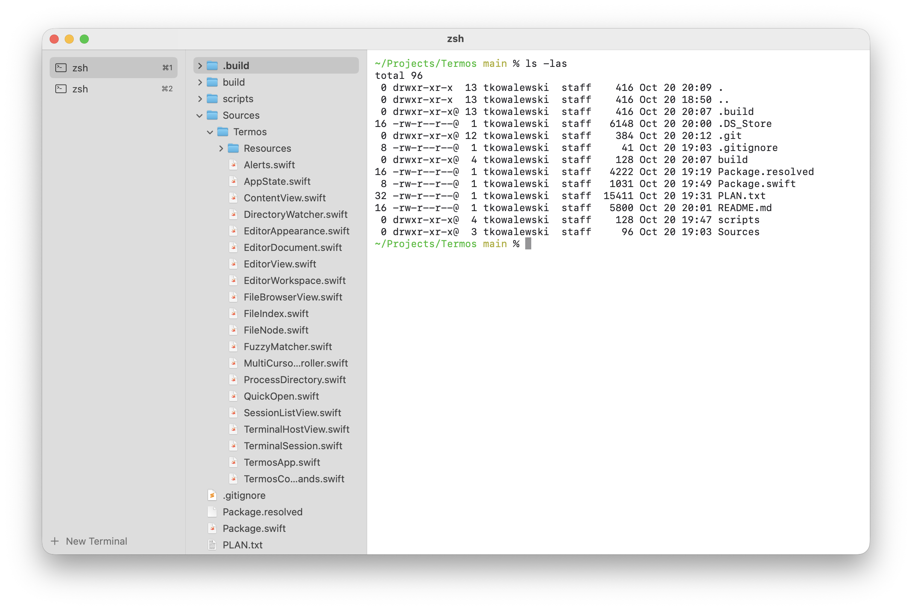
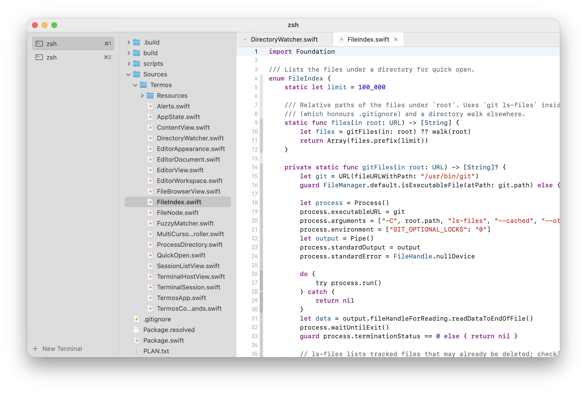
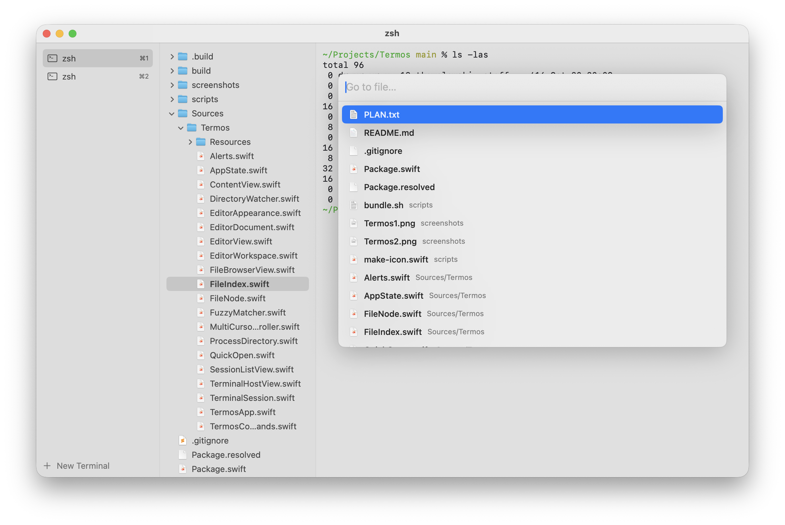

# Termos

Termos is a macOS terminal with a built-in file browser and code editor.

The main window is an ordinary terminal. When you need to look at or change a file, you open the file browser, which shows the terminal's current working directory. Click a file and it opens in an editor in place of the terminal. Several terminals can run side by side, and each one keeps its own open files.







## Features

### Terminals
- Multiple terminals, listed in a sidebar on the left. Each runs your login shell (`$SHELL`, started as a login shell like Terminal.app does).
- Terminals keep running in the background, with their scrollback, while you work in another one.
- Each terminal keeps 10,000 lines of scrollback.
- A new terminal opens in the working directory of the current one.
- Click the name of the active terminal (or use Rename Terminal in its context menu) to rename it. An empty name brings back the title set by the shell.
- <kbd>⌥</kbd> types characters from your keyboard layout (e.g. <kbd>⌥L</kbd> gives `ł` on the Polish layout) instead of acting as Meta. <kbd>⌥←</kbd> / <kbd>⌥→</kbd> still jump by word.
- Typing `exit` in the shell closes its terminal. Closing the last terminal quits the app.

### File browser
- Hidden by default. Toggle it with <kbd>⌘B</kbd>.
- Shows the working directory of the active terminal, read straight from the shell process, so it works with any shell and needs no shell configuration.
- While visible, it follows `cd` in the terminal and switches with the active terminal.
- Updates live when files are created, deleted or renamed on disk.
- Remembers which folders were expanded for each directory.
- Hides `.git`, `node_modules` and `.DS_Store`.
- Keyboard: arrows to move, <kbd>Return</kbd> to open a file or expand a folder, <kbd>Esc</kbd> to close.

### Editor
- Opens in place of the terminal. The terminal keeps running behind it.
- Syntax highlighting (tree-sitter) with Xcode-like light and dark themes.
- Long lines do not wrap; scroll sideways to see them.
- Indents with two spaces: <kbd>Tab</kbd> and the automatic indentation after <kbd>Return</kbd> insert spaces, not tab characters.
- Tabs for open files. A dot on a tab marks unsaved changes.
- Undo history and cursor position are kept per file when switching tabs.
- Saving removes spaces and tabs at the ends of lines, except in Markdown files, where two trailing spaces mean a line break. <kbd>⌘Z</kbd> brings them back in one step.
- Detects changes made on disk, for example from the terminal. Unchanged files reload silently; if you have unsaved edits, Termos asks first.
- Asks before discarding unsaved changes when closing a file or terminal, and when quitting.
- Refuses binary files and files larger than 10 MB.
- Find in file (<kbd>⌘F</kbd>), provided by the editor component.

### Multiple cursors (VS Code style)
- Add the next occurrence of the selection (<kbd>⌘D</kbd>), skip one (<kbd>⌘K</kbd> <kbd>⌘D</kbd>), select all occurrences (<kbd>⇧⌘L</kbd>), undo the last cursor (<kbd>⌘U</kbd>).
- Add cursors with <kbd>⌥</kbd>-click or on the line above or below (<kbd>⌥⌘↑</kbd> / <kbd>⌥⌘↓</kbd>).
- Typing, deleting and moving apply to every cursor. Copy joins the selections as lines. Pasting as many lines as there are cursors gives each cursor its own line.
- <kbd>Esc</kbd> first collapses multiple cursors to one. The next <kbd>Esc</kbd> returns to the terminal.

### Go to file
- <kbd>⌘P</kbd> opens a fuzzy finder for the active terminal's working directory. It works in the terminal and in the editor; the chosen file opens in the editor.
- In a git repository it lists files with `git ls-files`, so `.gitignore` is respected. Elsewhere it walks the directory with the file browser's filters.
- Ranking favours matches in the file name, at word boundaries and in consecutive characters.

## Keyboard shortcuts

### Terminals
| Shortcut | Action |
| --- | --- |
| <kbd>⌘T</kbd> | New terminal |
| <kbd>⌘W</kbd> | Close the open file in the editor, otherwise close the terminal |
| <kbd>⌘1</kbd> … <kbd>⌘8</kbd> | Switch to terminal 1–8 |
| <kbd>⌘9</kbd> | Switch to the last terminal |
| <kbd>⇧⌘[</kbd> / <kbd>⇧⌘]</kbd> | Previous / next terminal |

### Files and editor
| Shortcut | Action |
| --- | --- |
| <kbd>⌘B</kbd> | Show or hide the file browser |
| <kbd>⌘P</kbd> | Go to file |
| <kbd>⌘`</kbd> | Switch between the terminal and the editor |
| <kbd>⌘S</kbd> | Save the file |
| <kbd>⌘F</kbd> | Find in file |
| <kbd>Esc</kbd> | Collapse multiple cursors; otherwise go back to the terminal |

### Multiple cursors
| Shortcut | Action |
| --- | --- |
| <kbd>⌘D</kbd> | Select the word, then add the next occurrence |
| <kbd>⌘K</kbd> <kbd>⌘D</kbd> | Skip the current occurrence and add the next one |
| <kbd>⇧⌘L</kbd> | Select all occurrences |
| <kbd>⌘U</kbd> | Remove the last added cursor |
| <kbd>⌥</kbd>-click | Add a cursor |
| <kbd>⌥⌘↑</kbd> / <kbd>⌥⌘↓</kbd> | Add a cursor on the line above / below |

### Go to file
| Shortcut | Action |
| --- | --- |
| <kbd>↑</kbd> / <kbd>↓</kbd> | Move through results |
| <kbd>Return</kbd> | Open the selected file |
| <kbd>Esc</kbd> | Close |

## Building

Requirements: macOS 14 or later to run. Building needs Xcode 26 or later
(Swift 6.2), because SwiftTerm and swift-collections require Swift tools 6.2.

```sh
swift run                  # build and run from the command line
scripts/bundle.sh          # build build/Termos.app (release, arm64 + x86_64)
scripts/bundle.sh debug    # build build/Termos.app (debug, this Mac only)
open build/Termos.app
```

`bundle.sh` signs ad-hoc, which is enough on the Mac that built it. To run Termos on other Macs, build a signed and notarized zip with a Developer ID Application certificate:

```sh
xcrun notarytool store-credentials termos --apple-id you@example.com --team-id TEAMID   # once
TERMOS_SIGN_IDENTITY="Developer ID Application: Name (TEAMID)" scripts/release.sh
```

This produces `build/Termos.zip`, which opens without Gatekeeper warnings on macOS 14 or later.

### Releases

Pushing a version tag builds, signs and notarizes Termos on GitHub Actions and publishes `Termos-<version>.zip` as a GitHub release:

```sh
git tag v0.2.0 && git push origin v0.2.0
```

The workflow (`.github/workflows/release.yml`) lists the repository secrets it needs.

You can also open `Package.swift` in Xcode.

The app icon is drawn by a script. To regenerate `Sources/Termos/Resources/AppIcon.icns` after changing it:

```sh
swift scripts/make-icon.swift
```

## Built with

- [SwiftTerm](https://github.com/migueldeicaza/SwiftTerm): terminal emulation
- [CodeEditSourceEditor](https://github.com/CodeEditApp/CodeEditSourceEditor) and [CodeEditTextView](https://github.com/CodeEditApp/CodeEditTextView): the editor, including multiple selections. CodeEditTextView is included in `Vendor/` with a fix for horizontal scrolling.
- [CodeEditLanguages](https://github.com/CodeEditApp/CodeEditLanguages): tree-sitter grammars for syntax highlighting

## Project layout

| Path | Contents |
| --- | --- |
| `Sources/Termos/` | The app: state (`AppState`), terminals, file browser, editor, multiple cursors, go to file |
| `Sources/Termos/Resources/` | App icon |
| `Vendor/CodeEditTextView/` | Patched copy of CodeEditTextView (see its README) |
| `scripts/bundle.sh` | Builds `build/Termos.app` |
| `scripts/release.sh` | Builds a signed, notarized `build/Termos.zip` |
| `.github/workflows/release.yml` | Publishes a GitHub release for each `v*` tag |
| `scripts/make-icon.swift` | Draws the app icon |
| `PLAN.txt` | Original implementation plan (in Polish) |
